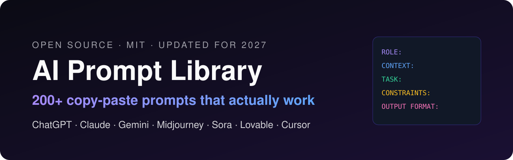

<div align="center">

<a href="https://promptitin.com/?utm_source=github&utm_medium=prompt-library&utm_campaign=readme&utm_content=banner"></a>

**The most detailed copy-paste AI prompt library on GitHub.**
Every prompt is built to get expert-level answers from ChatGPT, Claude, Gemini, Midjourney, Sora and AI coding tools, updated for 2027 models.

[](https://github.com/shakirdmr/ai-prompt-library/stargazers)
[](https://github.com/shakirdmr/ai-prompt-library/network/members)
[](#-whats-inside)
[](https://github.com/shakirdmr/ai-prompt-library/commits/main)
[](LICENSE)
[](CONTRIBUTING.md)

<a href="https://chromewebstore.google.com/detail/promptit/dcnofbodfdmkljndkfnldlllclggnnbd?utm_source=github&utm_campaign=readme"></a>
<a href="https://promptitin.com/?utm_source=github&utm_medium=prompt-library&utm_campaign=readme&utm_content=badge"></a>

[**Browse the website**](https://shakirdmr.github.io/ai-prompt-library/) · [Categories](#-whats-inside) · [Try one now](#-try-one-in-30-seconds) · [Chrome extension](#-skip-the-copy-paste) · [Contribute](CONTRIBUTING.md)

</div>

---

## Why most AI prompts fail

Most people type:

> *"Write me a resume."*

and get something generic they'd never use. The model isn't the problem. A vague prompt gets a vague answer, even from GPT-5, Claude or Gemini 3.

Every prompt here uses five parts, plus a 2027 footer:

| Part | What it does |
|---|---|
| **Role** | Tells the AI which expert to be, not "a helpful assistant" |
| **Context** | Your situation: the details it needs to give *your* answer |
| **Task** | Exactly what to produce, in numbered steps |
| **Constraints** | Rules on tone, length, honesty and what to avoid |
| **Output format** | How the answer should be laid out, so you can use it straight away |
| **2027 footer** | Ask before guessing · check the latest data and cite sources · suggest the next step |

→ [Read the full prompt engineering guide](https://promptitin.com/guides/what-is-prompt-engineering?utm_source=github&utm_medium=prompt-library&utm_campaign=readme)

---

## 📚 What's inside

| Category | Prompts | Best with |
|---|---|---|
| 📸 [**Image & Video Prompts with Results**](#-image-and-video-prompts-with-results) **NEW** | 104 | Nano Banana, ChatGPT, Midjourney, FLUX · Veo, Sora, Kling, Runway |
| 🧑‍💻 [**Vibe Coding Prompts**](vibe-coding-prompts/) **NEW** | 25 | Lovable, Bolt, v0, Replit, Cursor, Claude Code, Codex |
| 🎨 [AI Image Prompts](ai-image-prompts/) | 50 | Midjourney V7, ChatGPT (GPT Image), Gemini (Nano Banana), Firefly, Flux |
| 🎬 [Video Prompts](video-prompts/) | 50 | ChatGPT, Claude, Gemini · Sora 2, Veo 3, Runway, Kling |
| 📄 [Resume Writing Prompts](resume-prompts/) | 12 | ChatGPT, Claude, Gemini |
| 💼 [Job Search Prompts](job-search-prompts/) | 35 | ChatGPT, Claude, Gemini |
| 💰 [Salary Negotiation Prompts](salary-negotiation-prompts/) | 30 | ChatGPT, Claude |
| 🔎 [SEO Prompts](seo-prompts/) | 13 | ChatGPT, Claude, Perplexity |

New prompts every month. **[⭐ Star the repo](https://github.com/shakirdmr/ai-prompt-library)** to get them in your GitHub feed.

---

<!-- visual-library:start -->
## 📸 Image and video prompts with results

104 prompts for AI images and videos: 79 image prompts for Nano Banana (Gemini), ChatGPT, Midjourney and FLUX, and 25 video prompts for Veo, Sora, Kling and Runway. Each one links to a page with the result, a breakdown of what every part of the prompt does, and variations to try.

| Category | Kind | Prompts |
|---|---|---|
| [Christmas photo prompts](prompts/christmas.md) | Image | 20 |
| [Gemini AI photo prompts](prompts/gemini-photo.md) | Image | 21 |
| [Couple photo prompts](prompts/couple.md) | Image | 10 |
| [AI photo editing prompts](prompts/photo-editing.md) | Image | 15 |
| [3D figurine prompts](prompts/figurine.md) | Image | 8 |
| [AI product photo prompts](prompts/product-photo.md) | Image | 10 |
| [Cinematic video prompts](prompts/cinematic.md) | Video | 10 |
| [Product video prompts](prompts/product-video.md) | Video | 5 |
| [Social video prompts](prompts/social-video.md) | Video | 5 |
| [Nature video prompts](prompts/nature.md) | Video | 5 |

A prompt can sit in more than one category, so the rows add up to more than 104.

**How to use one**

1. Copy the prompt from its code block.
2. Paste it into the model named on the entry. If it says **Upload your photo first**, upload a clear photo of yourself to Gemini or ChatGPT, then paste.
3. Change the details (clothes, place, light) to fit what you want.

**Prompts by model**

- **Nano Banana Pro** (Google (Gemini)): 38
- **GPT Image** (OpenAI (ChatGPT)): 33
- **Midjourney V7** (Midjourney): 3
- **FLUX.2** (Black Forest Labs): 5
- **Veo 3.1** (Google): 11
- **Sora 2** (OpenAI): 4
- **Kling 2.5** (Kuaishou): 8
- **Runway Gen-4** (Runway): 2

### Christmas AI Photo Prompts

Christmas portraits, family cards and festive edits. Upload your photo, paste the prompt, keep your face. 20 prompts, 4 shown here. [See all 20](prompts/christmas.md).

#### Cozy fireplace Christmas portrait

**Model:** Nano Banana Pro | **Aspect ratio:** 4:5 | **Upload your photo first**

```text
Using my uploaded photo, keep my face, hair and expression exactly the same. Place me sitting on a soft armchair beside a lit stone fireplace on Christmas Eve, wearing a cream cable-knit sweater and holding a mug of hot chocolate with marshmallows. A tall decorated tree with warm white lights stands behind me, stockings hang on the mantel. Warm firelight on one side of my face, soft bokeh from the tree lights, natural skin texture, photo taken on a 50mm lens. Vertical 4:5 frame.
```

[Result, breakdown and variations →](https://promptitin.com/p/christmas-fireplace-portrait?utm_source=github&utm_medium=prompt-library&utm_campaign=visual&utm_content=christmas-fireplace-portrait)

#### Matching family pyjama photo

**Model:** Nano Banana Pro | **Aspect ratio:** 3:2 | **Upload your photo first**

```text
Using my uploaded family photo, keep every person's face and body shape exactly the same. Dress everyone in matching red and green tartan pyjamas and sit them close together on a big sofa in a living room on Christmas morning. A decorated tree glows on the left, wrapped presents are piled on the rug, and string lights hang along the window. Everyone is laughing naturally. Soft morning daylight mixed with warm tree lights, sharp faces, candid family photo look. Horizontal 3:2 frame.
```

[Result, breakdown and variations →](https://promptitin.com/p/christmas-family-pyjamas?utm_source=github&utm_medium=prompt-library&utm_campaign=visual&utm_content=christmas-family-pyjamas)

#### Snowy street at night

**Model:** GPT Image | **Aspect ratio:** 4:5 | **Upload your photo first**

```text
Take the person in my uploaded photo and keep their face exactly as it is. Put them on a narrow old-town street at night during light snowfall, wearing a camel wool coat and a red knitted scarf. Shop windows are decorated with garlands and warm lights, a big lit Christmas tree stands at the end of the street. Snowflakes are caught in their hair. Shallow depth of field, cinematic street lights, slight film grain. Vertical 4:5 frame.
```

[Result, breakdown and variations →](https://promptitin.com/p/christmas-snowy-street-portrait?utm_source=github&utm_medium=prompt-library&utm_campaign=visual&utm_content=christmas-snowy-street-portrait)

#### Baby's first Christmas

**Model:** Nano Banana Pro | **Aspect ratio:** 1:1 | **Upload your photo first**

```text
Using my uploaded photo of my baby, keep the baby's face exactly the same. Lay the baby on a soft white faux-fur blanket under a Christmas tree, wearing a tiny red knitted Santa hat and a cream romper. Small wrapped presents and a few pine cones sit around the blanket. The tree lights make warm round bokeh above. Bright, soft, clean newborn photography style, gentle smile, square 1:1 frame.
```

[Result, breakdown and variations →](https://promptitin.com/p/christmas-baby-first-christmas?utm_source=github&utm_medium=prompt-library&utm_campaign=visual&utm_content=christmas-baby-first-christmas)

[See all 20 in this category →](prompts/christmas.md)

### Gemini AI Photo Prompts (Nano Banana)

Upload your own photo to Gemini or ChatGPT and place yourself in a new scene, era or style with the same face. 21 prompts, 4 shown here. [See all 21](prompts/gemini-photo.md).

#### Matching family pyjama photo

**Model:** Nano Banana Pro | **Aspect ratio:** 3:2 | **Upload your photo first**

```text
Using my uploaded family photo, keep every person's face and body shape exactly the same. Dress everyone in matching red and green tartan pyjamas and sit them close together on a big sofa in a living room on Christmas morning. A decorated tree glows on the left, wrapped presents are piled on the rug, and string lights hang along the window. Everyone is laughing naturally. Soft morning daylight mixed with warm tree lights, sharp faces, candid family photo look. Horizontal 3:2 frame.
```

[Result, breakdown and variations →](https://promptitin.com/p/christmas-family-pyjamas?utm_source=github&utm_medium=prompt-library&utm_campaign=visual&utm_content=christmas-family-pyjamas)

#### 1950s vintage Christmas photo

**Model:** GPT Image | **Aspect ratio:** 1:1 | **Upload your photo first**

```text
Turn my uploaded photo into a 1950s Christmas snapshot. Keep my face exactly the same. I wear a period outfit, a fitted dress with a round collar or a cardigan and tie, and stand beside a silver tinsel tree with big coloured bulbs in a mid-century living room. Faded Kodachrome colours, slight colour shift, rounded white photo border, soft focus at the edges. Square 1:1 frame.
```

[Result, breakdown and variations →](https://promptitin.com/p/christmas-vintage-1950s-card?utm_source=github&utm_medium=prompt-library&utm_campaign=visual&utm_content=christmas-vintage-1950s-card)

#### Retro saree portrait

**Model:** Nano Banana Pro | **Aspect ratio:** 4:5 | **Upload your photo first**

```text
Using my uploaded photo, keep my face exactly the same. Turn it into a 90s Bollywood-style retro portrait: I wear a flowing red chiffon saree, a small flower tucked behind my ear, standing against a plain warm-toned wall with a soft shadow. Hair moves gently in a breeze. Grainy film texture, warm golden afternoon light from one side, dreamy and cinematic. Vertical 4:5 frame.
```

[Result, breakdown and variations →](https://promptitin.com/p/gemini-saree-retro-portrait?utm_source=github&utm_medium=prompt-library&utm_campaign=visual&utm_content=gemini-saree-retro-portrait)

#### Polaroid hug with your younger self

**Model:** Nano Banana Pro | **Aspect ratio:** 1:1 | **Upload your photo first**

```text
I'm uploading two photos: one of me now and one of me as a child. Create a Polaroid photo of the two of us hugging, keeping both faces exactly as in the photos. Slight blur as if taken with an instant camera, soft flash, a plain white curtain behind us. The Polaroid has a white border, slight colour fade and soft shadows. Natural, warm, emotional. Square 1:1 frame.
```

[Result, breakdown and variations →](https://promptitin.com/p/gemini-polaroid-with-younger-self?utm_source=github&utm_medium=prompt-library&utm_campaign=visual&utm_content=gemini-polaroid-with-younger-self)

[See all 21 in this category →](prompts/gemini-photo.md)

### AI Couple Photo Prompts

Couple portraits for anniversaries, save-the-dates and profile pictures, from one photo of the two of you. 10 prompts, 4 shown here. [See all 10](prompts/couple.md).

#### Paris night walk

**Model:** Nano Banana Pro | **Aspect ratio:** 4:5 | **Upload your photo first**

```text
Using my uploaded photo of us as a couple, keep both faces exactly the same. Show us walking hand in hand along the Seine in Paris at night, laughing at each other, the lit Eiffel Tower behind us and warm street lamps along the river. I wear a long coat, my partner a dark jacket. Candid film photo look, soft grain, shallow depth of field. Vertical 4:5 frame.
```

[Result, breakdown and variations →](https://promptitin.com/p/couple-paris-night-walk?utm_source=github&utm_medium=prompt-library&utm_campaign=visual&utm_content=couple-paris-night-walk)

#### Save the date on the beach

**Model:** GPT Image | **Aspect ratio:** 4:5 | **Upload your photo first**

```text
Using my uploaded photo of us, keep both faces exactly the same. Create a save-the-date photo: we stand barefoot at the edge of the sea at sunset, foreheads touching, waves around our ankles. Light linen outfits in white and sand tones. Warm pink and gold sky, soft backlight. Leave calm sky in the upper third and add the text "Save the date" in a thin elegant script. Vertical 4:5 frame.
```

[Result, breakdown and variations →](https://promptitin.com/p/couple-save-the-date-beach?utm_source=github&utm_medium=prompt-library&utm_campaign=visual&utm_content=couple-save-the-date-beach)

#### 1970s road trip

**Model:** Nano Banana Pro | **Aspect ratio:** 4:5 | **Upload your photo first**

```text
Using my uploaded photo of us, keep both faces exactly the same. Make it a 1970s road trip photo: we lean against a vintage turquoise convertible on an empty desert highway, wearing flared jeans, a suede jacket and big sunglasses. Red rocks and a long straight road behind us. Faded warm film colours, light leaks, slight grain, square-ish snapshot crop. Vertical 4:5 frame.
```

[Result, breakdown and variations →](https://promptitin.com/p/couple-1970s-road-trip?utm_source=github&utm_medium=prompt-library&utm_campaign=visual&utm_content=couple-1970s-road-trip)

#### Dancing in the kitchen

**Model:** GPT Image | **Aspect ratio:** 4:5 | **Upload your photo first**

```text
Using my uploaded photo of us, keep both faces exactly the same. Show us slow dancing barefoot in our small kitchen in the evening, one of us twirling the other, both laughing. Pasta on the stove, a glass of wine on the counter, fairy lights over the window. Cosy oversized sweaters. Warm tungsten light, slight motion blur on the spin, candid documentary photo. Vertical 4:5 frame.
```

[Result, breakdown and variations →](https://promptitin.com/p/couple-cozy-kitchen-dance?utm_source=github&utm_medium=prompt-library&utm_campaign=visual&utm_content=couple-cozy-kitchen-dance)

[See all 10 in this category →](prompts/couple.md)

### AI Photo Editing Prompts

Fix light, swap backgrounds, restore old photos and retouch with one sentence instead of an editing app. 15 prompts, 4 shown here. [See all 15](prompts/photo-editing.md).

#### Remove people from the background

**Model:** Nano Banana Pro | **Aspect ratio:** 4:5 | **Upload your photo first**

```text
Edit my uploaded photo: remove every person in the background except me. Fill the space where they stood with what would naturally be there, matching the ground, walls and light. Do not change me, my pose, my clothes or the colours of the photo. Keep the same framing and resolution.
```

[Result, breakdown and variations →](https://promptitin.com/p/edit-remove-background-people?utm_source=github&utm_medium=prompt-library&utm_campaign=visual&utm_content=edit-remove-background-people)

#### Restore an old family photo

**Model:** GPT Image | **Aspect ratio:** 4:5 | **Upload your photo first**

```text
Restore my uploaded old photo. Remove scratches, dust, creases and tears, fix the faded areas and sharpen the faces gently without changing anyone's features, age or expression. Then colourise it with natural, period-correct colours: realistic skin tones, muted clothing colours, soft light. Keep the original framing and grain so it still looks like a real photo from that time.
```

[Result, breakdown and variations →](https://promptitin.com/p/edit-restore-old-photo?utm_source=github&utm_medium=prompt-library&utm_campaign=visual&utm_content=edit-restore-old-photo)

#### Swap the background for a studio

**Model:** Nano Banana Pro | **Aspect ratio:** 4:5 | **Upload your photo first**

```text
Replace the background of my uploaded photo with a plain light grey seamless studio backdrop with a soft gradient shadow behind me. Keep me exactly as I am: face, hair edges, clothes, pose. Relight me to match soft studio light from the front left so it looks like one photo, and keep hair strands natural around the edges.
```

[Result, breakdown and variations →](https://promptitin.com/p/edit-change-background-studio?utm_source=github&utm_medium=prompt-library&utm_campaign=visual&utm_content=edit-change-background-studio)

#### Fix a dark backlit photo

**Model:** GPT Image | **Aspect ratio:** 4:5 | **Upload your photo first**

```text
My uploaded photo is backlit and my face is too dark. Brighten the people's faces and front of their bodies as if a soft fill light was used, while keeping the bright background exactly as it is. Keep skin tones natural, no orange or grey cast, no halo around the edges. Do not change any faces, clothes or the composition.
```

[Result, breakdown and variations →](https://promptitin.com/p/edit-fix-lighting-backlit?utm_source=github&utm_medium=prompt-library&utm_campaign=visual&utm_content=edit-fix-lighting-backlit)

[See all 15 in this category →](prompts/photo-editing.md)

### 3D Figurine AI Prompts

Turn yourself, your pet or your product into a collectible figure, toy box or clay model. 8 prompts, 4 shown here. [See all 8](prompts/figurine.md).

#### You inside a snow globe

**Model:** Nano Banana Pro | **Aspect ratio:** 1:1 | **Upload your photo first**

```text
Using my uploaded photo, make a small realistic figure of me, with my face, hair and clothes matched exactly, standing inside a glass snow globe. Inside the globe: a tiny snowy village with a lit tree and falling snow. The globe sits on a wooden base with a brass plate, on a mantel with pine garland and candles. Macro product photography, reflections on the glass, warm background bokeh. Square 1:1 frame.
```

[Result, breakdown and variations →](https://promptitin.com/p/christmas-snow-globe?utm_source=github&utm_medium=prompt-library&utm_campaign=visual&utm_content=christmas-snow-globe)

#### 3D animated character of you

**Model:** GPT Image | **Aspect ratio:** 1:1 | **Upload your photo first**

```text
Turn my uploaded photo into a 3D animated movie character, keeping my hairstyle, glasses, clothes and face shape recognisable. Big expressive eyes, soft rounded features, smooth subsurface skin, detailed fabric. I sit at a desk with a laptop and a plant, smiling at the camera. Soft studio lighting, warm colours, polished family animation look. Square 1:1 frame.
```

[Result, breakdown and variations →](https://promptitin.com/p/gemini-pixar-style-character?utm_source=github&utm_medium=prompt-library&utm_campaign=visual&utm_content=gemini-pixar-style-character)

#### Collectible figure on a desk

**Model:** Nano Banana Pro | **Aspect ratio:** 1:1 | **Upload your photo first**

```text
Make a 1/7 scale collectible figure of the person in my uploaded photo, matching face, hair and outfit exactly. The figure stands on a round clear acrylic base on a tidy wooden desk. Behind it, a printed retail box with the figure's artwork, and a monitor showing the figure's 3D sculpt in modelling software. Realistic product photo, soft window light, shallow depth of field. Square 1:1 frame.
```

[Result, breakdown and variations →](https://promptitin.com/p/figurine-collectible-desk?utm_source=github&utm_medium=prompt-library&utm_campaign=visual&utm_content=figurine-collectible-desk)

#### Action figure in a blister pack

**Model:** GPT Image | **Aspect ratio:** 3:4 | **Upload your photo first**

```text
Turn the person in my uploaded photo into an action figure sealed in a toy blister pack, with face and outfit matched. The card backing is bold and colourful with the name "ALEX" at the top and the tagline "Coffee powered". Accessories in their own slots: a laptop, a coffee cup, headphones and a phone. Studio product photo on a plain background, glossy plastic reflections. Vertical 3:4 frame.
```

[Result, breakdown and variations →](https://promptitin.com/p/figurine-action-figure-blister?utm_source=github&utm_medium=prompt-library&utm_campaign=visual&utm_content=figurine-action-figure-blister)

[See all 8 in this category →](prompts/figurine.md)

### AI Product Photo Prompts

Studio packshots and lifestyle scenes for stores, ads and launches, without a photographer. 10 prompts, 4 shown here. [See all 10](prompts/product-photo.md).

#### Skincare bottle with water splash

**Model:** FLUX.2 | **Aspect ratio:** 4:5

```text
Product photo of a frosted glass serum bottle with a white dropper cap, standing on a wet slab of pale grey stone. A clear water splash frozen mid-air behind the bottle, tiny droplets on the glass. Soft blue-green gradient background, a single soft light from above right with a crisp highlight on the bottle edge. High-end beauty advertising, ultra sharp, no text on the bottle. Vertical 4:5 frame.
```

[Result, breakdown and variations →](https://promptitin.com/p/product-skincare-water-splash?utm_source=github&utm_medium=prompt-library&utm_campaign=visual&utm_content=product-skincare-water-splash)

#### Floating sneaker

**Model:** GPT Image | **Aspect ratio:** 4:5

```text
A white and orange running sneaker floating in mid-air at a dynamic angle, laces slightly lifted, a few small pieces of foam and dust drifting around it. Solid deep orange background, hard rim light from behind and a soft key light from the front, sharp shadow on an invisible floor below. Clean, bold sneaker drop advertising style, ultra detailed materials, no logos. Vertical 4:5 frame.
```

[Result, breakdown and variations →](https://promptitin.com/p/product-sneaker-floating?utm_source=github&utm_medium=prompt-library&utm_campaign=visual&utm_content=product-sneaker-floating)

#### Coffee bag lifestyle shot

**Model:** FLUX.2 | **Aspect ratio:** 4:5

```text
A matte kraft paper coffee bag with a blank white label standing on a wooden café counter, coffee beans spilled in front, a hand grinder and a ceramic pour-over dripper beside it, steam rising from a cup. Morning sunlight through a window making long soft shadows. Warm, honest lifestyle product photo, shallow depth of field, focus on the bag. Vertical 4:5 frame.
```

[Result, breakdown and variations →](https://promptitin.com/p/product-coffee-bag-lifestyle?utm_source=github&utm_medium=prompt-library&utm_campaign=visual&utm_content=product-coffee-bag-lifestyle)

#### Jewellery macro on silk

**Model:** Midjourney V7 | **Aspect ratio:** 4:5

```text
Macro photograph of a thin gold ring with a single emerald-cut green gemstone resting on folds of champagne silk, tiny sparkles in the stone, soft reflections on the polished gold, very shallow depth of field, soft diffused light with one specular highlight, luxury jewellery advertising, clean and elegant --ar 4:5 --style raw
```

[Result, breakdown and variations →](https://promptitin.com/p/product-jewelry-macro?utm_source=github&utm_medium=prompt-library&utm_campaign=visual&utm_content=product-jewelry-macro)

[See all 10 in this category →](prompts/product-photo.md)

### Cinematic AI Video Prompts

Film-style shots for Veo, Sora, Kling and Runway: one subject, one camera move, one light. 10 prompts, 4 shown here. [See all 10](prompts/cinematic.md).

#### Lighthouse in a storm

**Model:** Veo 3.1 | **Aspect ratio:** 16:9

```text
Wide shot of a lone white lighthouse on a black rock at night during a violent storm. Huge waves crash against the rocks and spray into the air, rain lashes sideways, the lighthouse beam sweeps across the frame. Camera: slow dolly push-in toward the lighthouse over 8 seconds. Cold blue moonlight with flashes of lightning. Sound: roaring waves, heavy rain, distant thunder. Cinematic, 35mm film look.
```

[Result, breakdown and variations →](https://promptitin.com/p/video-lighthouse-storm-dolly?utm_source=github&utm_medium=prompt-library&utm_campaign=visual&utm_content=video-lighthouse-storm-dolly)

#### Swordsman in a bamboo forest

**Model:** Kling 2.5 | **Aspect ratio:** 16:9

```text
A lone swordsman in a dark grey robe walks slowly through a tall misty bamboo forest at dawn, one hand resting on the sword at his hip. Leaves drift down through beams of light. Camera: steady side tracking shot moving with him at walking pace, bamboo stalks passing in the foreground. Cool green tones with warm light shafts. Sound: wind in the bamboo, soft footsteps. Cinematic, anamorphic look.
```

[Result, breakdown and variations →](https://promptitin.com/p/video-samurai-bamboo-forest?utm_source=github&utm_medium=prompt-library&utm_campaign=visual&utm_content=video-samurai-bamboo-forest)

#### Neon city walk in the rain

**Model:** Sora 2 | **Aspect ratio:** 16:9

```text
A young woman in a clear raincoat walks away from the camera down a narrow neon-lit street at night in light rain. Puddles reflect pink and blue signs, steam rises from a street vent, people with umbrellas pass by. Camera: handheld follow shot behind her at shoulder height, slight natural sway. Sound: rain on the coat, distant traffic, muffled music from a bar. Moody, realistic, shallow depth of field.
```

[Result, breakdown and variations →](https://promptitin.com/p/video-neon-city-rain-walk?utm_source=github&utm_medium=prompt-library&utm_campaign=visual&utm_content=video-neon-city-rain-walk)

#### Rider crossing the desert

**Model:** Veo 3.1 | **Aspect ratio:** 16:9

```text
A rider on a dark horse gallops across huge golden sand dunes at sunset, a trail of sand lifting behind them, long shadows across the ripples. Camera: high drone shot following from behind and slowly rising to reveal endless dunes to the horizon. Warm orange light, clear sky. Sound: wind, hooves on sand, a horse snorting. Epic, cinematic, sharp.
```

[Result, breakdown and variations →](https://promptitin.com/p/video-desert-rider-drone?utm_source=github&utm_medium=prompt-library&utm_campaign=visual&utm_content=video-desert-rider-drone)

[See all 10 in this category →](prompts/cinematic.md)

### AI Product Video Prompts

Short product reveals and ad shots that loop well on a store page or in a feed. 5 prompts, 4 shown here. [See all 5](prompts/product-video.md).

#### Perfume bottle orbit

**Model:** Veo 3.1 | **Aspect ratio:** 9:16

```text
A glass perfume bottle with pale pink liquid stands on a round mirror plinth against a soft beige backdrop. Camera: slow 360-degree orbit around the bottle over 8 seconds. A soft light moves across so highlights glide over the glass and the liquid glows. Tiny dust sparkles in the air. Sound: soft ambient pad. Luxury product ad, clean, vertical 9:16.
```

[Result, breakdown and variations →](https://promptitin.com/p/video-perfume-bottle-orbit?utm_source=github&utm_medium=prompt-library&utm_campaign=visual&utm_content=video-perfume-bottle-orbit)

#### Sneaker drop with dust impact

**Model:** Kling 2.5 | **Aspect ratio:** 9:16

```text
A white high-top sneaker drops from above onto rough concrete and lands with a burst of dust that spreads out in slow motion. Camera: low static angle at ground level. Hard top light, dark grey background, crisp dust particles. Sound: deep thud, a whoosh of air. Bold sneaker ad, vertical 9:16.
```

[Result, breakdown and variations →](https://promptitin.com/p/video-sneaker-drop-impact?utm_source=github&utm_medium=prompt-library&utm_campaign=visual&utm_content=video-sneaker-drop-impact)

#### Coffee pour macro

**Model:** Veo 3.1 | **Aspect ratio:** 1:1

```text
Macro close-up of cold milk pouring into a glass of iced coffee, swirling clouds forming between ice cubes in slow motion. Camera: static, very close, shallow depth of field. Bright window light from behind making the glass glow. Sound: soft pour, ice clinking. Fresh café ad, square 1:1.
```

[Result, breakdown and variations →](https://promptitin.com/p/video-coffee-pour-macro?utm_source=github&utm_medium=prompt-library&utm_campaign=visual&utm_content=video-coffee-pour-macro)

#### Cream texture swirl

**Model:** Kling 2.5 | **Aspect ratio:** 9:16

```text
Extreme close-up of a small spatula scooping and swirling thick white face cream in an open glass jar, the texture forming soft peaks. Camera: slow push-in. Clean soft light, pale peach background, a few water droplets on the jar. Sound: soft creamy texture sounds, gentle music. Beauty ad, vertical 9:16.
```

[Result, breakdown and variations →](https://promptitin.com/p/video-skincare-cream-texture?utm_source=github&utm_medium=prompt-library&utm_campaign=visual&utm_content=video-skincare-cream-texture)

[See all 5 in this category →](prompts/product-video.md)

### AI Video Prompts for Reels, TikTok and Shorts

Vertical 9:16 clips built to hook in the first second. 5 prompts, 4 shown here. [See all 5](prompts/social-video.md).

#### POV morning routine

**Model:** Sora 2 | **Aspect ratio:** 9:16

```text
POV first-person shot: a hand turns off a phone alarm on a bedside table, then the view moves to a kitchen where the same hand pours coffee into a mug, then walks to a big window and opens the curtains to reveal a sunny city skyline. Smooth handheld POV with natural head movement. Bright soft morning light. Sound: alarm beep, coffee pouring, curtains sliding, birds outside. Aesthetic lifestyle reel, vertical 9:16.
```

[Result, breakdown and variations →](https://promptitin.com/p/video-pov-morning-routine?utm_source=github&utm_medium=prompt-library&utm_campaign=visual&utm_content=video-pov-morning-routine)

#### Outfit change on a snap

**Model:** Kling 2.5 | **Aspect ratio:** 9:16

```text
A young woman stands in front of a mirror in a plain white t-shirt and jeans, looks at the camera and snaps her fingers. On the snap, a quick flash-cut changes her outfit to an elegant black evening dress with gold earrings, same pose, same room. Camera: static at chest height. Bright, clean bedroom light. Sound: a sharp finger snap and a bass drop. Fashion transition reel, vertical 9:16.
```

[Result, breakdown and variations →](https://promptitin.com/p/video-outfit-transition-snap?utm_source=github&utm_medium=prompt-library&utm_campaign=visual&utm_content=video-outfit-transition-snap)

#### Street food hook shot

**Model:** Veo 3.1 | **Aspect ratio:** 9:16

```text
Extreme close-up of a street food vendor flipping a sizzling stuffed flatbread on a big hot griddle at a night market, oil bubbling, steam rising into the neon light, a cheese pull as it is cut in half and lifted toward the camera. Camera: quick push-in at the start, then static. Sound: loud sizzle, crowd chatter, a knife cutting. Mouth-watering food reel, vertical 9:16.
```

[Result, breakdown and variations →](https://promptitin.com/p/video-street-food-hook?utm_source=github&utm_medium=prompt-library&utm_campaign=visual&utm_content=video-street-food-hook)

#### Talking head in a café

**Model:** Veo 3.1 | **Aspect ratio:** 9:16

```text
A friendly man in his late 20s with a short beard and a denim shirt sits at a café table and talks directly to the camera with natural hand gestures, smiling. He says: "Here are three AI tools I use every single day." Café blurred behind, soft window light. Camera: static selfie-style framing at eye level, slight handheld feel. Sound: his voice clear and close, soft café ambience. Creator reel, vertical 9:16.
```

[Result, breakdown and variations →](https://promptitin.com/p/video-talking-head-cafe?utm_source=github&utm_medium=prompt-library&utm_campaign=visual&utm_content=video-talking-head-cafe)

[See all 5 in this category →](prompts/social-video.md)

### AI Nature Video Prompts

Landscapes, weather and wildlife shots for b-roll, backgrounds and calm loops. 5 prompts, 4 shown here. [See all 5](prompts/nature.md).

#### Waterfall in the jungle

**Model:** Veo 3.1 | **Aspect ratio:** 16:9

```text
A tall waterfall pours into a deep green pool in a dense tropical jungle, mist rising with a faint rainbow in the sunlight. Camera: drone starts low over the pool and rises slowly up the face of the waterfall to reveal the jungle canopy stretching to distant mountains. Lush green, bright soft light. Sound: roaring water, birds, insects. Nature documentary, 4K look.
```

[Result, breakdown and variations →](https://promptitin.com/p/video-waterfall-mist-drone?utm_source=github&utm_medium=prompt-library&utm_campaign=visual&utm_content=video-waterfall-mist-drone)

#### Northern lights over a lake

**Model:** Veo 3.1 | **Aspect ratio:** 16:9

```text
Timelapse of bright green and violet northern lights dancing over a frozen lake surrounded by snowy pine trees and mountains, stars moving slowly across the sky, the aurora reflected on patches of clear ice. A small red cabin with a lit window on the shore. Camera: static wide shot on a tripod. Sound: soft wind, distant cracking ice. Calm, majestic.
```

[Result, breakdown and variations →](https://promptitin.com/p/video-northern-lights-timelapse?utm_source=github&utm_medium=prompt-library&utm_campaign=visual&utm_content=video-northern-lights-timelapse)

#### Ocean wave in slow motion

**Model:** Kling 2.5 | **Aspect ratio:** 16:9

```text
Low angle from the water's surface: a turquoise ocean wave curls and breaks in slow motion, sunlight shining through the thin lip of the wave, spray glittering in the air. Camera: static, almost at water level. Sound: deep wave crash, then a soft hiss. Calm, hypnotic, nature b-roll.
```

[Result, breakdown and variations →](https://promptitin.com/p/video-ocean-waves-slow-motion?utm_source=github&utm_medium=prompt-library&utm_campaign=visual&utm_content=video-ocean-waves-slow-motion)

#### Foggy forest at sunrise

**Model:** Runway Gen-4 | **Aspect ratio:** 16:9

```text
A quiet pine forest at sunrise filled with soft fog, golden sunbeams breaking through the trees in visible rays, dew on ferns on the forest floor. Camera: slow smooth glide forward between the trunks at eye level. Muted greens and warm gold. Sound: birdsong, a light breeze, a distant woodpecker. Peaceful, cinematic nature b-roll.
```

[Result, breakdown and variations →](https://promptitin.com/p/video-forest-fog-sunrise?utm_source=github&utm_medium=prompt-library&utm_campaign=visual&utm_content=video-forest-fog-sunrise)

[See all 5 in this category →](prompts/nature.md)

**Write your own:** describe an image in a few words in the free [Image Prompt Generator](https://promptitin.com/image-prompt-generator?utm_source=github&utm_medium=prompt-library&utm_campaign=visual&utm_content=readme-generator) and get a full prompt in this style.
<!-- visual-library:end -->

---

## ⚡ Try one in 30 seconds

Copy this, replace the `[brackets]`, and paste it into ChatGPT, Claude or Gemini:

```
ROLE: You are a career coach who has helped 2,000+ people land roles at top companies. You write resume bullet points that recruiters read in 6 seconds and remember.

CONTEXT:
- My role: [your job title]
- What I actually did: [paste 3–5 rough notes about your work]
- Job I'm applying for: [target job title, or paste the job description]

TASK:
1. Rewrite my notes as 5 achievement-focused bullet points
2. Lead every bullet with a strong verb and end it with a result
3. Add a realistic number to each bullet, or a [placeholder] I must fill in. Never invent numbers
4. Match the keywords in the job description

CONSTRAINTS:
- Under 25 words per bullet
- No "responsible for", "helped with" or "various"

OUTPUT FORMAT:
- 5 bullets, best first
- Below them: the 3 job-description keywords I'm still missing

> Before you start: If my notes are too vague, ask me one question first. When done, tell me the one bullet a recruiter would ask about in the interview.
```

More like this in [Resume Prompts](resume-prompts/) and [Job Search Prompts](job-search-prompts/).

---

## 🧩 Skip the copy-paste

Filling in brackets gets old. **[PromptIt](https://promptitin.com/?utm_source=github&utm_medium=prompt-library&utm_campaign=readme&utm_content=section)** does it for you: type a rough idea like *"cover letter for a nursing job"* and get a full, structured prompt like the ones in this library.

**The [free Chrome extension](https://chromewebstore.google.com/detail/promptit/dcnofbodfdmkljndkfnldlllclggnnbd?utm_source=github&utm_campaign=readme)** puts it inside the tools you already use: write a quick prompt in ChatGPT, Claude, Lovable, Bolt, Replit or v0, click **Enhance**, and send the better version.

| Without PromptIt | With PromptIt |
|---|---|
| Find a prompt, copy it, fill 8 brackets, paste | Type one line, click Enhance |
| One prompt per situation | A prompt written for *your* situation |
| Switch tabs to the library | Works inside the chat box |

[**Add to Chrome — free**](https://chromewebstore.google.com/detail/promptit/dcnofbodfdmkljndkfnldlllclggnnbd?utm_source=github&utm_campaign=readme) · [**Open PromptIt**](https://promptitin.com/?utm_source=github&utm_medium=prompt-library&utm_campaign=readme&utm_content=section)

---

## How to use

1. Pick a category above
2. Find the prompt that fits your situation
3. Copy the whole block, including every section
4. Replace everything in `[brackets]` with your real details
5. Paste into ChatGPT, Claude, Gemini, Grok, DeepSeek or Perplexity

**2027 tips**

- **Turn on web search** (ChatGPT, Claude, Gemini, Perplexity) for anything with prices, salaries, laws or trends. Every prompt asks the AI to check the latest data and cite sources when it can.
- **Attach files instead of pasting.** Resumes, job descriptions, screenshots and spreadsheets work better as uploads.
- **Use the reasoning modes** (ChatGPT Thinking, Claude extended thinking, Gemini Deep Think) for negotiation, strategy and code. Use fast modes for quick rewrites.
- **Keep the conversation going.** Every prompt ends by suggesting your next step. Follow it in the same chat.

---

## ⭐ Star history

<a href="https://star-history.com/#shakirdmr/ai-prompt-library&Date">
  
</a>

If this library saved you time, **[star it](https://github.com/shakirdmr/ai-prompt-library)**. It's the only way other people find it.

---

## 🤝 Contributing

Pull requests are welcome. Add prompts to the right category, follow the five-part structure, and test them first. See [CONTRIBUTING.md](CONTRIBUTING.md).

Missing a category? [Request one](https://github.com/shakirdmr/ai-prompt-library/issues/new?template=prompt-request.yml).

## ☕ Support

This library is free and always will be. If it helped you land a job, a raise or a client, you can [buy me a coffee](https://buymeacoffee.com/shakirdmr).

<a href="https://buymeacoffee.com/shakirdmr"></a>

## License

[MIT](LICENSE): free to use, share and modify.

<div align="center">
<sub>Built by the maker of <a href="https://promptitin.com/?utm_source=github&utm_medium=prompt-library&utm_campaign=readme&utm_content=footer">PromptIt</a>, the AI prompt generator and optimizer.</sub>
</div>
